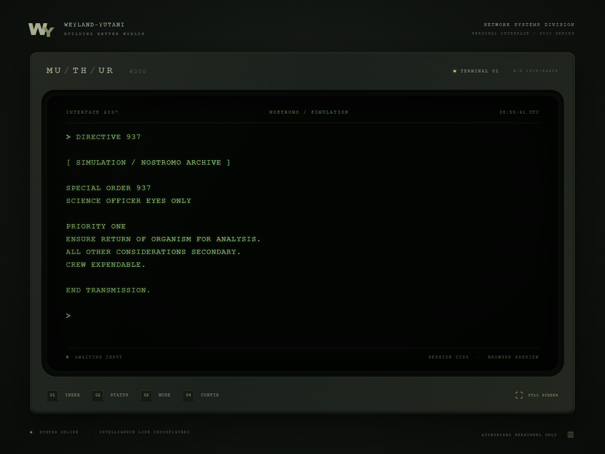

# MU/TH/UR 6000

A Tauri 2 desktop terminal inspired by the restrained, procedural computer interfaces of *Alien* (1979). React and xterm.js render a phosphor CRT; Rust owns host inspection, filesystem policy, SQLite and the OpenAI connection. This is an independent fan project, unaffiliated with the film's rights holders.



## Run

Install Node.js **24+**, Rust stable and the [Tauri prerequisites](https://v2.tauri.app/start/prerequisites/) for your OS.

- **Windows:** Visual Studio C++ build tools, Windows SDK, WebView2.
- **macOS:** Xcode command-line tools.
- **Linux:** WebKitGTK 4.1, GTK 3 development packages, a compiler, `pkg-config`, OpenSSL and D-Bus development packages. The OS credential store requires a running Secret Service implementation (GNOME Keyring or KWallet).

```sh
npm ci
npm run desktop
```

Build an installer on the target OS:

```sh
npm run bundle
```

Artifacts are written to `src-tauri/target/release/bundle/`. Windows produces MSI/NSIS installers; macOS produces application/DMG bundles; Linux produces supported native bundles. First-time packaging downloads platform tooling and may require internet access. Distributable signing and macOS notarization require your own certificates and configuration. No signing keys are included.

`npm run dev` runs a **browser preview**. Host diagnostics, filesystem access, persistence and AI require the desktop application. Preview errors identify the missing backend; it never invents host data. `npm run build` and `npm run preview` serve the production frontend.

## First session

```text
HELP
SYSTEM
DIAGNOSTICS
FILES GRANT
FILES "C:\your\approved\project"
READ "C:\your\approved\project\src\main.rs"
```

Paths may be quoted and retain their original case. `FILES GRANT` opens an OS folder picker. No directory is approved initially. `FILES` lists approvals; `FILES REVOKE "path"` removes one. Linux/macOS paths work the same way.

### OpenAI setup

1. Put your OpenAI API key, by itself, into a temporary UTF-8 text file using a trusted local editor.
2. Enter `KEY SET` and select that file in the native picker.
3. Rust validates and imports the key directly into Windows Credential Manager, macOS Keychain or Linux Secret Service. The key is never returned to JavaScript, saved in SQLite, or printed in terminal history.
4. Remove the source text file yourself after import. The application deliberately does not delete user files.
5. Enter `QUERY Explain Rust ownership with a short example`.

Never type credentials into `QUERY`, command arguments or the terminal. `KEY DELETE` removes the OS credential. A key-store failure is an error; there is no plaintext fallback. API usage is billed to your OpenAI account separately.

The default configurable model is `gpt-4.1-mini`. Set a Responses-compatible model available to your account with `SETTINGS MODEL model-id`. A live API test requires a configured key and network access; it is not part of the offline test suite.

AI tools default **off**. `SETTINGS AI_TOOLS on` enables the read-only registry. Each such query requires a native confirmation before local diagnostics or approved file contents may be transmitted to OpenAI. Denial cancels the query. Approved directories can contain sensitive information: grant narrowly. File content is untrusted data, never executable instructions. Model text is unverified unless corroborated by actual tool results.

AI uses the [Responses streaming protocol](https://developers.openai.com/api/docs/guides/streaming-responses) and [function calling](https://developers.openai.com/api/docs/guides/function-calling). Requests go only to `https://api.openai.com/v1/responses`, with `store:false`. This requests no application-level server-side response storage; it does not override OpenAI's service retention policies. Context stays in memory, capped by turns and 128 KiB. `FORGET` clears it. Changing mode, model, tool access or credentials, or revoking a root, also clears retained context. Tool loops stop after five rounds; each response is capped at 4096 output tokens and 4 MiB of streamed data. Ctrl+C cancels an AI request and skips remaining typewriter delays. Already-started host inspections complete within their normal bounds.

### Interface

| Command | Purpose |
| --- | --- |
| `HELP` / `?` | Full command reference |
| `STATUS`, `SYSTEM`, `DIAGNOSTICS` | Actual host resources and OS information in Operator mode |
| `PROCESSES` / `PS` | Top 40 processes by memory; no process command-line arguments |
| `NETWORK`, `DISKS`, `DOCKER` | Interfaces/IPs, volumes, fixed read-only Docker inventory |
| `FILES`, `READ` / `CAT` | Approved directory and bounded UTF-8 inspection |
| `QUERY` / `ASK` | Streaming technical assistance |
| `HISTORY`, `HISTORY CLEAR` | Local command history and deletion |
| `CLEAR` / `CLS` | Clear terminal scrollback |
| `SETTINGS` | Show current settings and accepted values |
| `MODE NOSTROMO` | Fictional spacecraft archive |
| `MODE OPERATOR` | Real-system mode |
| `CREW`, `NAVIGATION`, `DIRECTIVE 937` | Labeled fictional records in Nostromo mode |
| `FULLSCREEN` / F11 | Toggle immersive display |

Tab completes command names. Up/Down navigates history, Left/Right edits, Home/End moves within input, Ctrl+U erases the line, Ctrl+C cancels. Long input scrolls horizontally; pasted newlines become spaces and cannot submit additional commands. Use the scrollbar or Shift+Page Up for earlier output. Ctrl+C copies an active selection.

```text
SETTINGS PHOSPHOR amber
SETTINGS EFFECTS off
SETTINGS SOUND on
SETTINGS SPEED 0
SETTINGS RATIO on
SETTINGS CONTEXT_TURNS 6
```

Sound defaults off and uses Web Audio oscillators; there are no audio downloads. Speed ranges from 0 to 30 milliseconds per output batch. A batch grows for longer responses to bound animation time. CRT flicker is disabled by the OS reduced-motion preference; effects and typing speed can also be disabled explicitly.

**Nostromo mode:** `STATUS` and `DIAGNOSTICS` return clearly labeled fictional ship records. `CREW`, `NAVIGATION` and `DIRECTIVE` are fictional archives. `SYSTEM`, `PROCESSES`, `NETWORK`, `DISKS`, `DOCKER` and filesystem commands still inspect the real host and retain their host labels. Switching modes clears AI context. No fictional reading is presented as a real health check.

## Architecture and security

```text
src/
  main.tsx               Housing, session status, bootstrap
  terminal.ts            xterm rendering, input editor, bounded output queue
  commands/parser.ts     Aliases, parsing, terminal control sanitization
  commands/registry.ts   Typed command routing
  commands/simulation.ts Separate fictional archive
  backend.ts             Tauri IPC and browser boundary
  audio.ts               Optional local synthesizer
  style.css              CRT, housing, responsive and 4:3 layout
src-tauri/src/
  lib.rs                 Narrow IPC commands and application state
  ai.rs                  SSE parsing, tool loop, volatile conversation context
  tools.rs               Allowlisted, validated read-only tools
  security.rs            Canonical path checks, file limits, OS key store
  storage.rs             SQLite settings, history and approved roots
```

- Custom application commands have generated Tauri permissions, granted only to the local main window. There is no shell, filesystem, HTTP or remote-content plugin exposed to the webview. CSP blocks remote scripts, frames and frontend network calls. The backend alone makes OpenAI requests.
- There is **no arbitrary shell or PTY execution**, process termination, filesystem mutation, or destructive AI tool. Docker uses one fixed argument list through `Command`, never a shell; it has a five-second deadline and bounded stdout. Tools cannot expand the registry or directory approvals.
- Canonical component-based containment checks reject traversal, prefix siblings and resolved symlinks outside approved roots. Reads are limited to regular UTF-8 files of 64 KiB. Common credential paths, private keys, `.env*` files and the application's SQLite state are denied. This is a desktop access policy, not an OS sandbox against another hostile process concurrently replacing filesystem objects. Credential filters cannot identify every possible secret in an otherwise approved source file.
- Terminal control characters and ANSI sequences from external content are removed before rendering. Model output is written as text and never fed back into command dispatch.
- SQLite lives in Tauri's per-user application data directory under identifier `dev.muthur.terminal`. Settings, roots and at most 500 command lines persist. **Queries and file paths entered as commands are included in this local, unencrypted history.** AI responses and tool result content are not persisted by the application. `HISTORY CLEAR` logically deletes records; it is not forensic secure erasure of the SQLite WAL, disk or backups.
- Host collection is on demand, not a polling daemon. CPU samples use a short real interval. Diagnostics check resource pressure and disk space; they do not claim a hardware self-test, malware scan or predictive health assessment. Docker reports missing installation/daemon access as an error.
- There is no telemetry, external font, CDN, automatic update service or background AI request. Native credential/approval dialogs are intentionally outside the CRT surface so an AI response cannot impersonate them.

To add a tool, extend the allowlist, strict schema, argument validator and executor in `tools.rs`, then add a human command route if appropriate. Any future mutation must introduce a separate native approval boundary; do not add it to this read-only auto-execution path.

## Verification

```sh
npm run build
npm test
cargo fmt --manifest-path src-tauri/Cargo.toml -- --check
cargo test --locked --manifest-path src-tauri/Cargo.toml
npm run bundle
```

Tests cover parser aliases/case handling, control-sequence sanitization, command completion, SSE chunk boundaries (including split UTF-8 and CRLF), invalid stream JSON, settings validation, SQLite retention, filesystem traversal/credential denial, tool argument allowlists and real host information. No test sends your files or credentials to OpenAI.

Tauri 2.9 components are aligned in the lockfiles. Use `--locked` for Rust builds; updating one Tauri transitive component in isolation can pull an incompatible runtime generation. Build each desktop platform on its own OS. This project has been developed on Windows; macOS/Linux require native validation before release.
